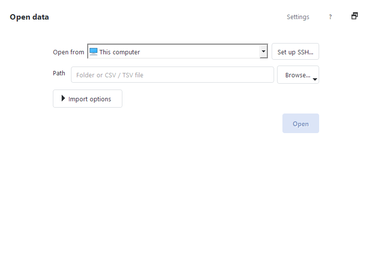
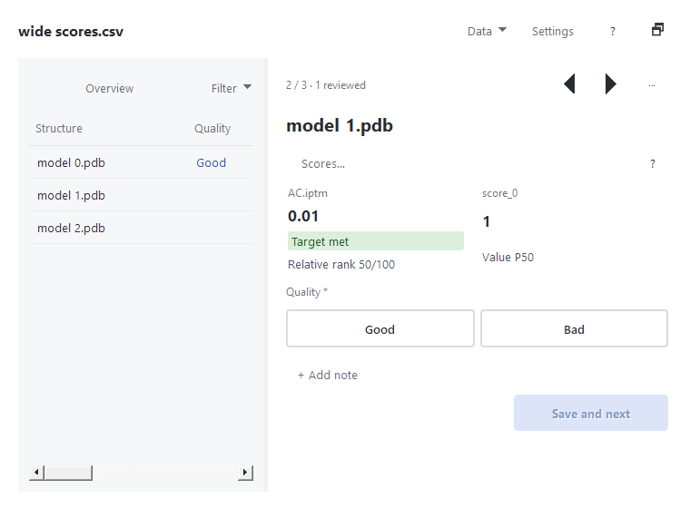
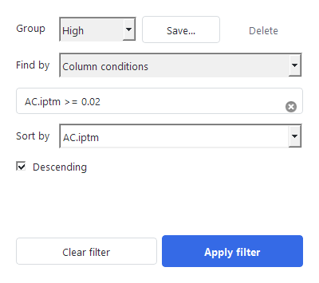
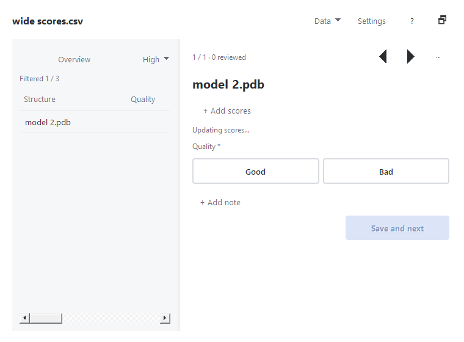

# Structure Annotator：边看结构边筛选和标注

> **典型用法：** 有 300 个设计结构和一张含 `iptm`、`plddt` 的评分表。先筛出高分候选，再逐个看三维结构、标记 `Good` / `Bad`；中断后接着上次位置看，不用手工在 PyMOL 和 Excel 之间来回切换。

下面的截图来自 **2026-10-22 在 gamma 电脑的 Windows PyMOL 3.1 上安装公开 0.16.0 ZIP 后进行的实际 GUI 操作**。截图用 3 个**测试结构**，不是上面所说的 300 个真实设计。

## 1. 安装

打开 [最新正式 Release](https://github.com/Molaison/pymol_scripts/releases/latest)，下载附件 **`PymolPlugins-<版本>.zip`**（不要下载 GitHub 的 Source code ZIP）。在桌面 PyMOL 里选 **Plugin → Plugin Manager → Install New Plugin**，选择 ZIP，完全退出并重开 PyMOL。菜单中出现 **PymolPlugins: Structure Annotator** 即可。

后续更新可使用 **Plugin → PymolPlugins: Updates** 检查新版；更新完成也要重启 PyMOL。

## 2. 打开结构文件夹或评分表

选择 **Plugin → PymolPlugins: Structure Annotator**，`Open from` 选 **This computer**，在 `Path` 选 PDB/CIF 文件夹或者 CSV/TSV，点 **Open**。如果加载表格时询问 **Structure column**，应选放 `.pdb` / `.cif` 路径的那一列，例如 `structure_path`，不要选 `iptm` 分数列。相对路径从表格所在目录解析，必要时在 **Import options → File locations** 设置基准目录。

**远端 SSH 数据也能直接打开。** 先在装有 PyMOL 的电脑终端确认 `ssh my-lab` 可成功连接，电脑上的 `~/.ssh/config` 有相应 `Host my-lab` 别名，再在 `Open from` 选它、填写远端 `/path/to/scores.tsv` 或结构目录。第一次使用可点 **Set up SSH…**；服务端需有 Python 3。它会按需下载结构、在电脑本地缓存和保存标注，**不会修改服务器上的原表和结构**。不必预先挂载 SSHFS；如果 SSH 仍要求 OTP，仍应按正常方式完成身份验证。

## 3. 看分数、做标签和继续上次审阅

在 **Review** 页看到当前结构、表格分数和标签。点击 `Good` / `Bad` 先选草稿，再点 **Save and next** 真正保存并跳到下一条；`+ Add note` 可以记原因。左侧列表能直接切换候选。

- **暂时看不准：** 在 **More → Mark current for later** 标记待复查；**Next unreviewed** 继续未审阅的条目，之后用 **Next marked for later** 集中处理。
- **中途退出：** 下次打开菜单 **Data → Continue last review**，恢复最近的数据源、筛选和位置。首次导入后，记录可能仍在后台保存；如果按钮暂时不可用，可在保存完成后重新进入 Open data / Data 页再试。此按钮只在你主动点击时恢复，不会启动就自动连远端。
- **撤销/交接：** 保存与标记写在独立的本地审阅记录，不会修改原始 CSV/PDB。可导出一份**新 CSV** 汇总标签；**Data → Export review handoff…** 只导出进度/标签 JSON，不包含结构文件本身。

## 4. 筛选、排序和保存候选组

例如评分列实际名叫 `iptm`，可在 **Filter → Column conditions** 输入 `iptm >= 0.8`，再按 `iptm` **Descending** 排序，先看高分设计。测试截图的列名是 `AC.iptm`，要按自己表头填写；高分本身不等于结构一定正确。

**Group** 可以保存 `High` 等常用条件，下次点组名直接复用；清除过滤则回到全体候选。筛选只改变当前显示范围，不会删除被排除的结构或评分。

## 5. 更多实用功能

| 要做什么 | 在哪里操作 | 相比手动操作的好处 |
| --- | --- | --- |
| 显示哪些评分列 | Review 页的列选择 | 只看 `iptm`、`plddt` 等关心的指标，不让几十列挤占视野 |
| 参考结构和候选一起显示、自动对齐 | **More → Review steps…** 或 **Settings → Automation → Review steps…** | 按步骤加载候选和固定参考，复用 PyMOL 命令；需自己配置参考路径与 `align` 命令 |
| 一键准备常见可视化 | **Settings → Automation → Viewing presets…** | 选择 cartoon、蛋白界面或口袋等预设，再预览和确认执行；不是自动给出科学结论 |
| 为标签动作生成命令草稿 | **Settings → Automation → AI command drafts…** | 生成可编辑的 PyMOL 命令，仍需预览、确认、Apply；需要可用 provider，不能把草稿当作已执行 |
| 继续同组审阅、交给同事 | **Data → Continue last review / Export review handoff…** | 保存进度与审阅路线，不必记住上次看到哪一行 |

设置详解及远端路径、Review steps 配置示例见 [完整功能说明（文字版）](structure_annotator_csv_walkthrough.md)。

## 实机测试范围

在 gamma 的 Windows PyMOL 3.1 / Qt 上，使用**公开的 0.16.0 Release ZIP**和临时测试数据，通过了插件安装、首次打开、三维结构加载、标签保存并前进、Later/未审阅导航、Continue last review、评分筛选与分组、handoff JSON、CSV/TSV 导入和配置恢复；测试输入哈希未变。以上截图均由真实 GUI 自动化操作抓取。

**未宣称全部场景都通过：** 这次没有从 gamma SSH 会话直接恢复用户历史中的远端真实 `sum_scores.csv`（Windows SSH 会话看不到原映射盘）；也没有实测 AI provider 或所有 Review steps 高级配置。首次导入后 History 异步写入时，Continue 按钮可能短暂不可用；另一个旧性能测试观察到主线程 `os.stat`，尚不能据此承诺固定的翻页延迟。以上不妨碍按本文先从本地样例开始使用。
