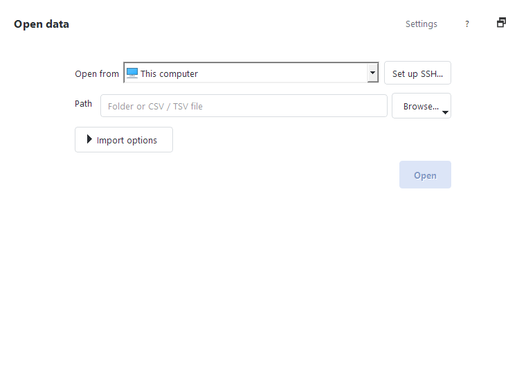
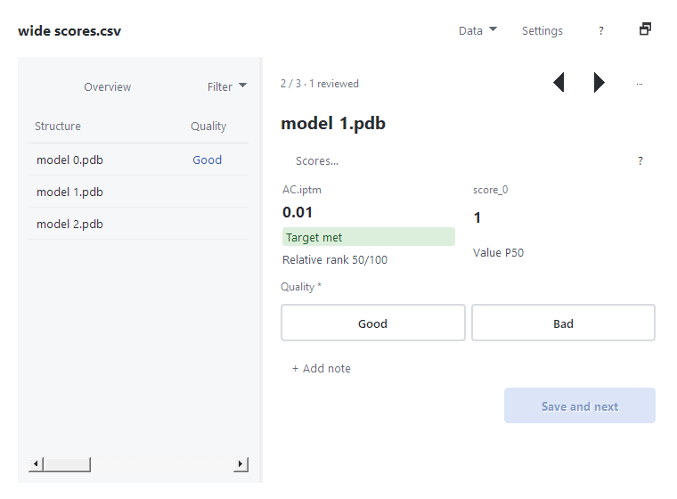
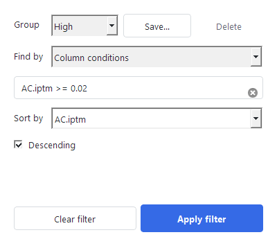
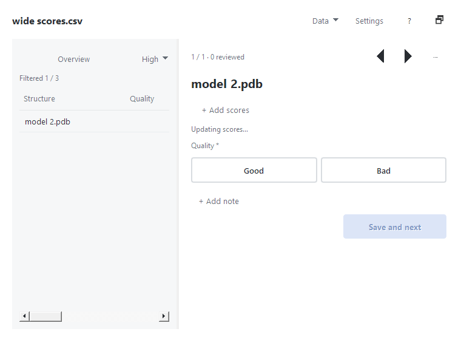

# 用 Structure Annotator 开始审阅

用自己的 PDB/CIF 目录或 CSV/TSV 评分表，在 PyMOL 中查看结构、筛选候选、保存标签并在下次继续。先准备带 Qt 和 Plugin Manager 的桌面 PyMOL，以及可访问的结构文件；不需要安装 WSL worker。

## 安装并打开

1. 从 [正式 Release](https://github.com/Molaison/pymol_scripts/releases/latest) 下载附件 `PymolPlugins-<版本>.zip`，不要选择自动生成的 Source code ZIP。
2. 在 PyMOL 选择 **Plugin → Plugin Manager → Install New Plugin**，选择原始 ZIP，不要解压。
3. 完全退出并重启 PyMOL，选择 **Plugin → PymolPlugins: Structure Annotator**。

本工作树还描述未正式发布的 0.17.0 候选功能；正式版以 Release 为准。后续可以通过 **Plugin → PymolPlugins: Updates** 检查更新，安装后同样需要重启。

## 导入结构或评分表

在 **Open from** 选择 **This computer**，在 **Path** 选择自己的 PDB/CIF 目录或 CSV/TSV，再点击 **Open**。支持压缩的 `.pdb.gz` / `.cif.gz`。询问 **Structure column** 时选择包含结构路径的列，例如 `structure_path`；相对路径默认相对于表格目录。必要时在 **Import options → File locations** 设置基准目录。

如果数据在 SSH 主机，先在运行 PyMOL 的电脑完成已有 SSH 设置，包括首次主机信任和私钥或密码步骤，并确认 `ssh my-lab` 可连接。然后在 **Open from** 选择该 Host 并输入远端路径；服务端需要 Python 3。插件按需下载结构并在本地保存标注，远端源文件只读。

需要自动填写 OTP 时，在 **Connections…** 的 **SSH server** 选择服务器，例如 `f101`，勾选 **Automatic OTP**，在 **OTP secret** 填写认证器的 Base32 设置密钥，点击 **OK**。不要填当前六位验证码。**Advanced → SSH program** 留空；如果以前明确保存了 `.py` wrapper，先清空该项。插件使用系统 OpenSSH，不需要安装或修改外部 wrapper。

默认密钥只在当前 PyMOL 进程有效；Windows 上勾选 **Remember encrypted key on this computer** 才用当前 Windows 用户的 DPAPI 加密保存。内置 OTP 不填写普通密码或私钥口令，也不自动接受新主机。提示不匹配、密钥保存和旧 wrapper 的兼容方式见 [SSH 步骤](structure_annotator_csv_walkthrough.md#连接-ssh-数据源)。

## 查看结构并保存标签

在 **Review** 查看当前三维结构、评分和标签。选择 `Good`、`Bad` 等标签只是草稿；点击 **Save and next** 才保存并进入下一条。可用 **+ Add note** 记录理由，也可在左侧列表切换候选。

暂时无法判断时选择 **More → Mark current for later**；**Next unreviewed** 和 **Next marked for later** 分别继续未审阅项和回看暂缓项。下次主动选择 **Data → Continue last review** 恢复来源、筛选和位置；面板不会自动连接历史 SSH 源。首次导入后历史记录仍在后台保存时，Continue 可能短暂不可用。

源结构和评分表不会被标注流程改写。需要交接时，**Data → Export review handoff…** 导出进度和标签摘要，但不包含结构；导出带标签的表格时选择新路径。

## 筛选并保存常用条件

打开 **Filter → Column conditions**，使用真实表头输入条件。例如列名实际为 `iptm` 时，可写 `iptm >= 0.8` 并按该列 **Descending** 排序。这个阈值只演示语法，是否适用由数据和科学判断决定。筛选只改变查看范围，不删除源数据。

在 **Group** 保存常用条件，再通过 Filter 旁的箭头切换；组可以重叠，不能当作质量标签。清除过滤可回到完整候选集合。

## 继续深入

- [CSV、SSH、Review steps 和缓存](structure_annotator_csv_walkthrough.md)：设置显示列、固定参考、命令和导出。
- [整理运行产物的 agent 提示词](02_agent_review.md)：从已有 raw 评分生成可审阅产物，不重算评分。
- [标注字段和评分](annotation_fields_and_score_guidance.md)：配置必填、多选、批量保存与评分方向。
- **Settings → Automation → Viewing presets… / AI command drafts…**：先预览和编辑，再确认插入并 Apply；生成草稿不会自动执行。

本页截图来自 2026-10-22 的 Windows PyMOL 3.1 / Qt 与公开 0.16.0 ZIP，使用三个测试结构。该次检查覆盖本地导入、保存、筛选和继续；没有在该次恢复用户历史远端 CSV，也没有实测所有 AI provider 和高级步骤。其他版本及新功能的证据按 [历史索引](03_history_index.md) 查阅。
